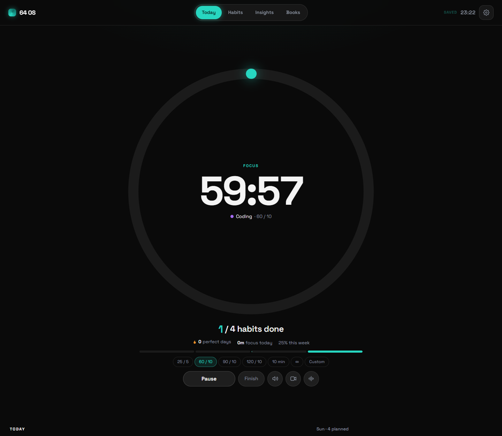

# 64 OS

A habit tracker and focus timer that runs on your own PC. You add your habits by hand, tick them off, time your work, and see your streaks and weeks. No account, no cloud, no AI: everything is saved in a file on your computer.



## What you need

- Windows 10 or 11
- [Node.js](https://nodejs.org) (the LTS version; install it with the default options)
- A browser (Chrome, Edge or Firefox)
- Internet only for the brown noise button (it plays a YouTube video). Everything else works offline.

## Install

1. On this GitHub page click **Code**, then **Download ZIP**, and unzip it somewhere you will keep it (for example `Documents\64os`). Or, with git: `git clone` this repository.
2. Install Node.js if you do not have it.
3. Double-click **`start.bat`**. The app opens in your browser at `http://127.0.0.1:6464`.

That is all. There is nothing to build: the app is the ready file `64os.html`, and `server.mjs` saves your data.

### Start it automatically when you log in (optional)

Double-click **`install-autostart.bat`** once. From then on the server starts by itself at every login (with no window), and a **64 OS** shortcut sits on your Desktop. Pin that page in your browser and you never need the `.bat` files again.

- To turn it off again: **`uninstall-autostart.bat`**.
- If you move the folder or reinstall Node.js, run `install-autostart.bat` again.
- **`stop.bat`** stops the server for now (it comes back at the next login if autostart is on).

## Your first five minutes

1. Open the gear (top right) and pick **Manage habits** (or press **+ Add your first habit** on the empty Today page).
2. For each habit fill in:
   - **Icon**: one emoji.
   - **Name**: what it is, for example `Reading` or `Gym`.
   - **min a day**: your daily target in minutes. When the timer (or minutes you add by hand) reaches it, the habit ticks itself. Put **0** for a habit that is only ticked, like `Drink water`.
   - **Days**: the lit days are the days the habit is planned. A day that is not lit shows a dash and never counts as a miss.
   - **Timer**: the timer mode the habit starts in (25/5, 60/10, 90/10, 120/10, 10 min, or ∞ for an open stopwatch).
3. Press **+ Add habit**. Change anything later right there: edits are saved as soon as you leave the field. The arrows change the order on Today; **Delete** removes a habit from every page (its old ticks stay in your data).

## Every day

**Today** is the main page.

- The big ring shows how much of today is done. When you pick a habit it turns into the timer.
- **Click a habit card** to select it. Then press **Start** (or Space, or click the ring). Clicking a card never starts the clock by itself.
- **Pause / Resume**, **Finish** (end the block now; the time is logged) and **Skip break** (end the break and wait for Start) sit under the ring.
- The row of modes above Start changes the block length. **Custom** asks for any number of minutes.
- The square on the left of a card ticks or unticks it by hand. Unticking today stops it from ticking itself again today.
- The small **+** next to the minutes adds time you did away from the timer.
- Keys: **Space** start or pause, **1 to 9** select a habit, **F** fullscreen.
- **Mindset**: one tap a day, 1 (drained) to 5 (fired up), with an optional line.
- **This week** shows each habit's days: green done, red missed, an outline for a day off.

Next to Start are three buttons:

- **Speaker**: plays the motivation audio (`media/motivation.mp3`). Click again to stop.
- **Video**: opens the motivation video (`media/motivation.mp4`) in a pop-up. Esc closes it.
- **Waves**: plays 8 hours of brown noise from YouTube ([Academic Brown](https://www.youtube.com/watch?v=0GDfOAuUvQ0)) in a small player in the corner. It keeps playing on every page until you press the button or the × again.

To use your own clips, put your files in the `media` folder with the same names (`motivation.mp4`, `motivation.mp3`). If a file is missing, its button is hidden.

## The other pages

- **Habits**: the month. Daily (a grid you can click to tick any past day, with streaks), Weekly (each week with **Copy .md**, which copies the week as a markdown table), Monthly (done over planned days and focus time).
- **Insights**: perfect days in a row, the last 28 days (misses, double misses, your weakest habit and day), your mindset average, focus against your targets this week, every week since you started, and a daily chain of squares.
- **Books**: your reading list. Minus and plus move 5 pages; click the number to type the page, the title to rename, the badge to change the status.
- **Settings** (gear): where your data is, **Backup** and **Restore**, fullscreen.

A few rules the numbers follow:

- A day is judged only from the day you started (and for each habit, from the day you added it), so nothing before counts as a miss.
- A **perfect day** is a day with every planned habit done.
- A miss is a miss. "Never miss twice": one missed day is a rest, two in a row is a pattern.

## Your data

- Everything is in **`data/os.json`** in this folder. The server keeps a daily copy in `data/backups` (the last 30 days).
- **Settings, Backup** downloads all your data as one file. **Restore** loads such a file back, after asking.
- The `data` folder is yours: it is never uploaded anywhere and git ignores it. Keep a backup when you move to a new PC.
- If the server is off, the page keeps your changes in the browser and saves them when the server is back.
- Opening `64os.html` directly (double-clicking it) also works, but then the data stays only in that browser. Use `start.bat`.

## Updating

Download the new version (or `git pull`) into the same folder. Your `data` folder stays as it is. If the server was running, run `stop.bat` and `start.bat` once so it picks up the new version.

## For developers

The source is in `src/` (React, built by esbuild into the single file `64os.html`). Node built-ins only for the server.

```
cd src
npm install
npx playwright install chromium   # only if you have no Chrome
npm run build                     # writes ../64os.html
npm test                          # the browser test (src/tests/smoke.test.mjs) and the server tests (test/)
```

The font is Space Grotesk under the SIL Open Font License (`assets/fonts/OFL.txt`).
